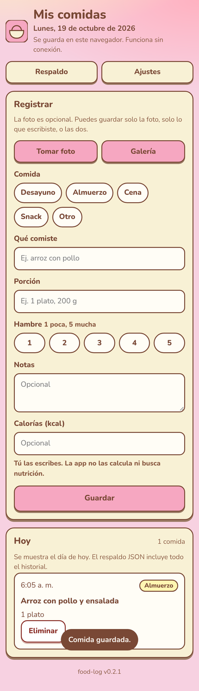

# 🍽️ food-log

> Registra lo que comes en segundos, con foto opcional. Funciona sin conexión y tus datos se quedan en tu navegador.

**[▶ Probar ahora](https://juliangdeveloper.github.io/food-log/)** · gratis, en el navegador, sin instalar ni crear cuenta



## Cómo se usa
- Toma una foto o elige una de la galería (opcional).
- Marca la comida (desayuno, almuerzo, cena, snack u otro) y escribe qué comiste y la porción.
- Si quieres, agrega hambre (1 a 5), notas y calorías; la app no las calcula por ti.
- Pulsa **Guardar**: la comida aparece en la lista de hoy.
- En **Respaldo** exportas o importas un JSON con todo el historial, fotos incluidas, para pasarlo a otro navegador.
- Instálala en la pantalla de inicio para usarla como app y evitar que el navegador borre los datos.

## Stack
JavaScript vanilla (módulos ES), `localStorage` para los registros e IndexedDB para las fotos, con service worker para uso offline. Sin servidor ni bundler.

```
python3 -m http.server 8000   # abrir http://localhost:8000
```

---

Más proyectos: https://juliangdeveloper.github.io/

Hecho con ❤️ y 🍽️
